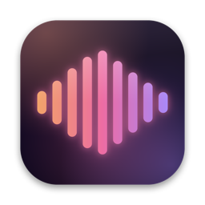
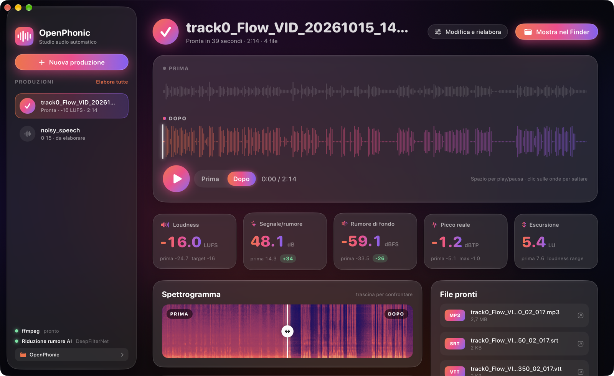

<p align="center"></p>

# OpenPhonic

Post-produzione audio automatica in stile [Auphonic](https://auphonic.com): riduzione rumore con
intelligenza artificiale, leveler adattivo, Voice AutoEQ, loudness EBU R128 esatta, taglio di pause e
parole riempitive, trascrizione e sottotitoli. Tutto in locale, nessun file lascia il tuo computer.

Il progetto ha tre versioni con lo stesso motore audio:

| | Cartella | Per chi | Tecnologia |
|---|---|---|---|
| **App per Mac** | [`macos/`](macos/README.md) | Uso personale sul Mac, interfaccia nativa | Swift, SwiftUI, Accelerate, Speech di Apple |
| **App per Windows 11** | [`windows/`](windows/README.md) | PC Windows x64 e ARM, installazione con un doppio clic | C#, WPF, .NET 10, Whisper.net |
| **Web app** | [`web/`](web/README.md) | Server, uso da browser, API REST, multitraccia | Python, FastAPI, Whisper, Docker |



## Il motore, in breve

```
voce in mono → passa-alto e ronzio → DeepFilterNet → Voice AutoEQ → Adaptive Leveler
→ compressore leggero → tagli → intro/outro → loudness esatta + true peak → esportazione
```

Su una registrazione reale da iPhone, rumorosa: rapporto segnale/rumore da 14 a 48 dB, loudness da
−24,7 a −16,0 LUFS, picco a −1,2 dBTP. Le tre versioni danno risultati identici entro 1 dB.

## Avvio rapido

App per Mac (macOS 26, Apple Silicon, `brew install ffmpeg`):

```bash
cd macos && ./tools/build-app.sh && open dist/OpenPhonic.app
```

App per Windows (da PowerShell, con il .NET 10 SDK), oppure lo zip già pronto con "Installa OpenPhonic":

```powershell
cd windows; powershell -ExecutionPolicy Bypass -File tools\build.ps1 -Rid win-x64 -Zip
```

Web app:

```bash
cd web && ./scripts/setup.sh && .venv/bin/uvicorn app.main:app --port 8765
```

## Aggiornamenti

Le app per Mac e Windows controllano all'avvio se su
[GitHub Releases](https://github.com/giuseppelupo1979/openphonic/releases) c'è una versione nuova. Se c'è,
compare un avviso nella barra laterale: **Aggiorna e riavvia** scarica il pacchetto giusto, ne verifica
l'impronta SHA-256 (e su Mac anche la firma), sostituisce l'app e la riapre. Cronologia e impostazioni
restano. La web app mostra un avviso con le novità e il comando per aggiornare il server.

### Pubblicare una versione

1. Alza il numero in `VERSION` e aggiungi la sezione corrispondente in `CHANGELOG.md`.
2. Committa, poi `tools/release.sh --dry-run` per preparare e controllare i pacchetti in `dist/release/`.
3. `tools/release.sh` crea il tag, compila Mac e Windows (x64 e ARM64, nella VM), calcola gli SHA-256 e
   pubblica la Release con le note del CHANGELOG.

Codice sotto licenza [MIT](LICENSE); i componenti di terze parti hanno le loro licenze (vedi i README delle singole versioni).

OpenPhonic non è affiliato ad Auphonic.
