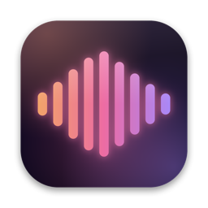
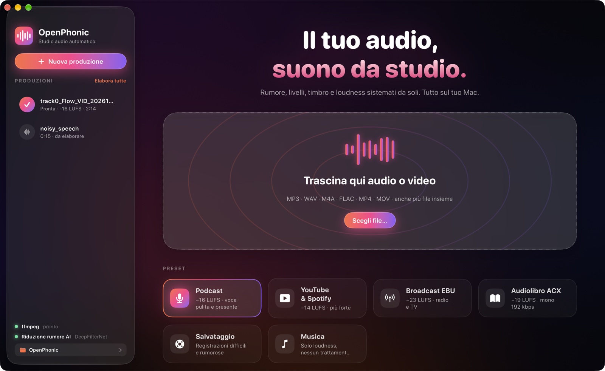
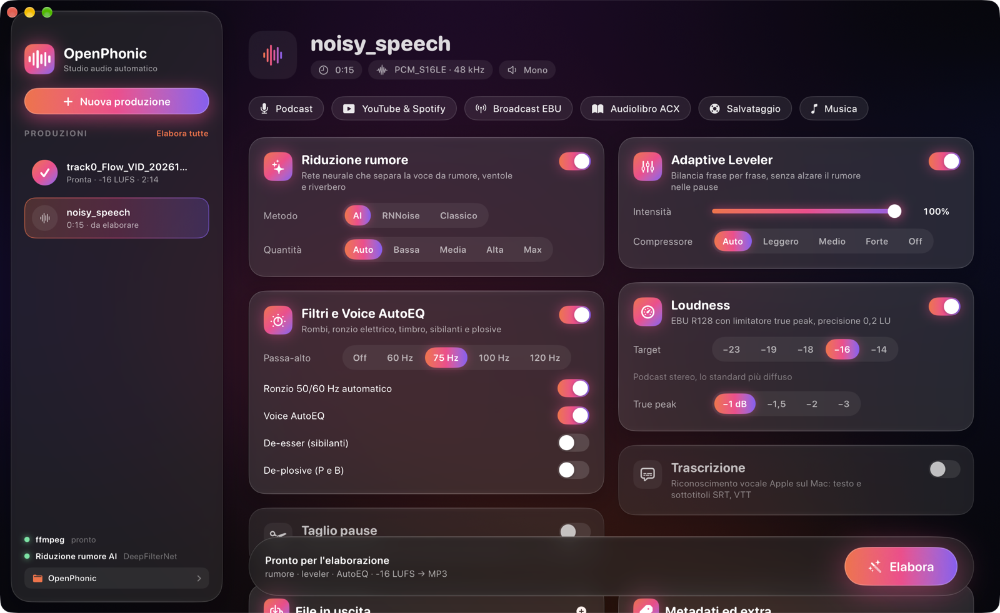
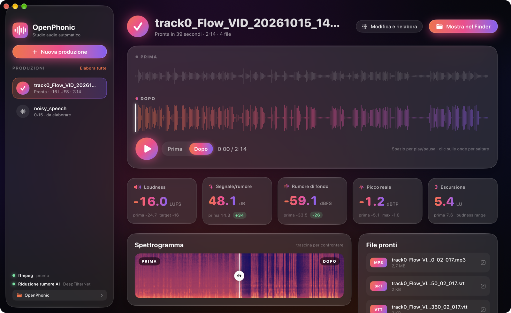

<p align="center"></p>

# OpenPhonic per macOS

App nativa per Mac, scritta in Swift e SwiftUI, che fa la stessa post-produzione audio della
[versione web](../web/README.md): carichi un file audio o video e ottieni una voce pulita, livellata e
alla loudness giusta. Niente server, niente Python, niente account: tutto gira sul tuo Mac.



---

## Cosa fa

| Funzione | Come è fatta |
|---|---|
| **Riduzione rumore AI** | DeepFilterNet incluso nell'app: separa la voce da rumore, ventole, traffico e parte del riverbero. La quantità si regola da sola sul rapporto segnale/rumore misurato. In alternativa RNNoise o riduzione spettrale. |
| **Adaptive Leveler** | Bilancia il volume frase per frase; nelle pause il guadagno resta fermo, così il rumore non viene mai alzato. |
| **Voice AutoEQ** | Corregge il timbro della voce verso lo spettro medio del parlato (massimo ±4 dB). |
| **Filtri** | Passa-alto, rilevamento automatico del ronzio a 50/60 Hz, de-esser, de-plosive. |
| **Loudness** | EBU R128, target −23/−19/−18/−16/−14 LUFS, limitatore true-peak con oversampling 4×, precisione 0,2 LU. |
| **Taglio pause e riempitivi** | Pause lunghe accorciate, ehm e uhm rimossi, con dissolvenze di 10 ms a ogni taglio. |
| **Trascrizione** | Riconoscimento vocale Apple on-device (`SpeechAnalyzer`): testo, sottotitoli SRT e VTT, tempi per parola. |
| **Video** | MOV e MP4 in ingresso: l'audio elaborato torna nel video, tagliato negli stessi punti se servono tagli (encoder hardware del Mac). |
| **Formati** | MP3, AAC (M4A), Opus, FLAC, WAV 24 bit, MP4; metadati e copertina incorporata. |
| **Intro e outro** | Aggiunti e normalizzati insieme al resto. |
| **Coda** | Trascini più file insieme, li elabori uno dopo l'altro con "Elabora tutte". |

La catena di elaborazione è la stessa della versione web, riscritta in Swift con Accelerate:
sullo stesso file i due motori danno risultati identici entro 1 dB.

## L'interfaccia

- **Home**: titolo, area di trascinamento con onde animate, scelta del preset (Podcast, YouTube & Spotify, Broadcast EBU, Audiolibro ACX, Salvataggio, Musica).
- **Impostazioni**: una scheda in vetro per ogni algoritmo, con interruttori, selettori a pillola e cursori a gradiente.



- **Elaborazione**: anello luminoso con percentuale e le fasi che si accendono una alla volta.
- **Risultato**: ascolto A/B sulle due forme d'onda (spazio per play/pausa, clic per saltare), statistiche prima e dopo, spettrogramma con cursore di confronto da trascinare, trascrizione cliccabile, file pronti da aprire o trascinare in un'altra app.



Tema scuro con sfondo aurora animato, pannelli Liquid Glass di macOS 26, gradiente arancio, rosa e viola.

---

## Requisiti

- macOS 26 o successivo, Mac con Apple Silicon
- [ffmpeg](https://ffmpeg.org) installato con Homebrew: `brew install ffmpeg`

DeepFilterNet e il modello RNNoise sono già dentro l'app. Al primo uso della trascrizione macOS
scarica il modello vocale della lingua scelta.

## Compilare l'app

Bastano i Command Line Tools di Xcode (non serve Xcode completo):

```bash
cd macos
./tools/build-app.sh
```

Lo script compila in release, scarica DeepFilterNet e il modello RNNoise se mancano, disegna l'icona,
crea `dist/OpenPhonic.app` e la firma con il certificato Apple Development se presente (altrimenti
firma ad-hoc). Per installarla:

```bash
ditto dist/OpenPhonic.app /Applications/OpenPhonic.app
```

L'icona è disegnata da codice in `tools/make-icon.swift`: si rigenera a ogni build.

### Modalità da riga di comando

Lo stesso eseguibile elabora un file senza aprire la finestra (utile per prove e automazioni):

```bash
/Applications/OpenPhonic.app/Contents/MacOS/OpenPhonic --process episodio.wav --out ~/Desktop/risultato --cut --transcribe --video
```

### Prova di tutte le opzioni

`tools/test-matrix.sh` elabora un file con ogni preset, ogni metodo e quantità di riduzione rumore,
ogni compressore e una corsa con tutto acceso (tutti i formati, intro, outro, copertina, tagli,
trascrizione). Stampa una riga per corsa e fallisce se una combinazione dà errore:

```bash
./tools/test-matrix.sh ~/Music/prova.mp3
```

---

## Struttura

```
Sources/OpenPhonic/
  Main.swift            avvio: interfaccia oppure modalità --process
  App.swift             finestra, menu, apertura file dal Dock / "Apri con"
  Engine/
    Pipeline.swift      la catena completa, dalla decodifica all'esportazione
    Leveler.swift       rilevamento voce, Adaptive Leveler, Voice AutoEQ, guadagno in streaming
    Analysis.swift      rumore, SNR, ronzio, forme d'onda, pause (Accelerate)
    Transcriber.swift   SpeechAnalyzer di Apple, sottotitoli
    FF.swift, Tools.swift  ffmpeg/ffprobe, DeepFilterNet
    Settings.swift      impostazioni e preset
  UI/
    Theme.swift         colori, sfondo aurora, vetro, bottoni, interruttori, selettori
    Sidebar.swift, HomeView.swift, SetupView.swift, ProcessingView.swift, ResultView.swift
    Model.swift         produzioni, coda, salvataggio in ~/Library/Application Support/OpenPhonic
tools/
  build-app.sh          crea e firma OpenPhonic.app
  test-matrix.sh        prova tutte le combinazioni di opzioni
  make-icon.swift       disegna l'icona
```

I file elaborati vanno in `~/Music/OpenPhonic/<nome>/` (la cartella si cambia dalla barra laterale).

## Note tecniche

- Nel SDK di macOS 26 `@State` è una macro il cui plugin c'è solo in Xcode: l'app usa l'alias `Local`
  del classico property wrapper, così si compila con i soli Command Line Tools.
- La build avviene in una cartella temporanea (`--scratch-path`) per evitare problemi del database di
  build di SwiftPM su cartelle sincronizzate.

## Limiti noti

- Niente multitraccia né capitoli, che invece ci sono nella versione web.
- Serve ffmpeg di Homebrew: non è incluso nell'app.
- L'app non è notarizzata: su un altro Mac al primo avvio va aperta con clic destro → Apri.
- Il riconoscimento vocale Apple non sempre trascrive le parole riempitive, quindi il loro taglio non le trova tutte.
