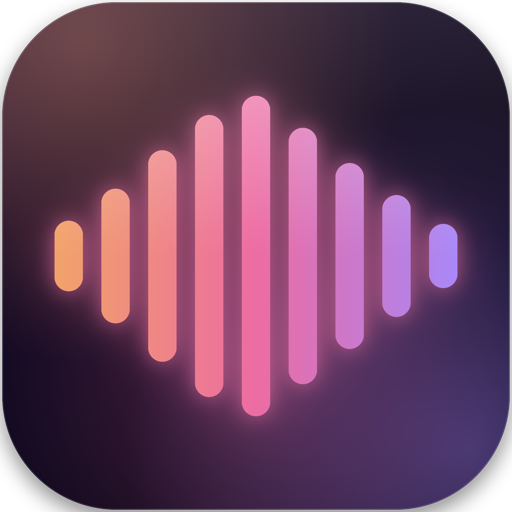
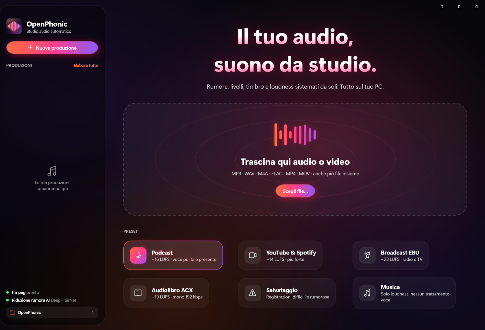
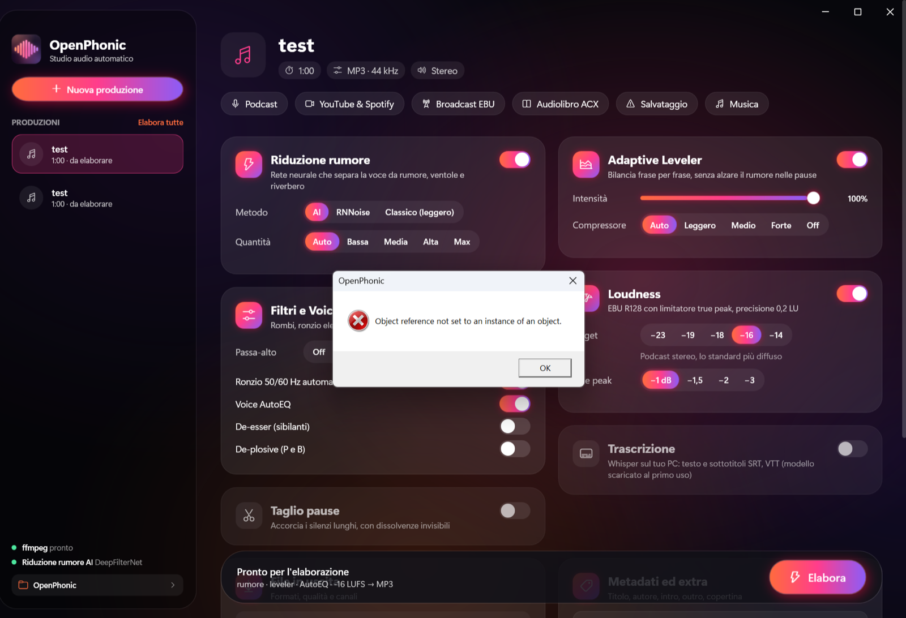
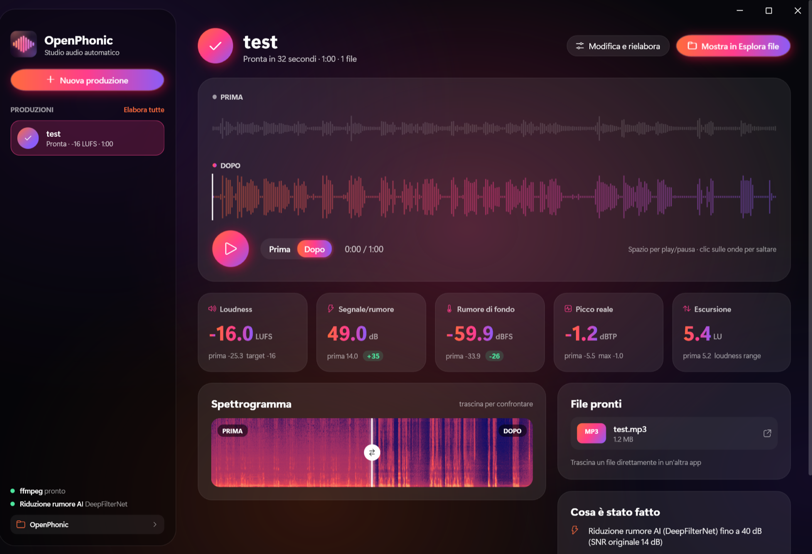

<p align="center"></p>

# OpenPhonic per Windows 11

App nativa per Windows 11, scritta in C# con WPF su .NET 10, che fa la stessa post-produzione audio
delle versioni [Mac](../macos/README.md) e [web](../web/README.md): carichi un file audio o video e
ottieni una voce pulita, livellata e alla loudness giusta. Niente server, niente account: tutto gira
sul tuo PC, e ffmpeg, DeepFilterNet e Whisper sono già dentro l'app.



---

## Installazione

1. Scarica lo zip della tua architettura:
   - **OpenPhonic-win-x64.zip** per i PC con processore Intel o AMD (quasi tutti);
   - **OpenPhonic-win-arm64.zip** per i PC con processore ARM (Snapdragon, Surface Pro X, Parallels su Mac).
2. Estrai lo zip in una cartella qualsiasi.
3. Fai doppio clic su **Installa OpenPhonic**.

L'installazione non chiede la password di amministratore: copia l'app in
`%LOCALAPPDATA%\Programs\OpenPhonic`, crea i collegamenti sul desktop e nel menu Start e la registra
in **Impostazioni → App → App installate**, da dove si disinstalla come qualsiasi programma.

Al primo avvio Windows può mostrare "Windows ha protetto il PC" perché l'app non è firmata con un
certificato commerciale: clic su **Ulteriori informazioni → Esegui comunque**.

## Cosa fa

| Funzione | Come è fatta |
|---|---|
| **Riduzione rumore AI** | DeepFilterNet incluso nell'app: separa la voce da rumore, ventole, traffico e parte del riverbero. La quantità si regola da sola sul rapporto segnale/rumore misurato. In alternativa RNNoise o riduzione spettrale (che impara il profilo del rumore dal tratto più silenzioso). |
| **Adaptive Leveler** | Bilancia il volume frase per frase; nelle pause il guadagno resta fermo, così il rumore non viene mai alzato. |
| **Voice AutoEQ** | Corregge il timbro della voce verso lo spettro medio del parlato (massimo ±4 dB); non alza gli acuti se la voce è ancora rumorosa. |
| **Filtri** | Passa-alto, rilevamento automatico del ronzio a 50/60 Hz, de-esser, de-plosive. |
| **Loudness** | EBU R128, target −23/−19/−18/−16/−14 LUFS, limitatore true-peak con oversampling 4×, precisione 0,2 LU. |
| **Taglio pause e riempitivi** | Pause lunghe accorciate, ehm e uhm rimossi, con dissolvenze di 10 ms a ogni taglio. |
| **Trascrizione** | Whisper in locale (whisper.cpp tramite Whisper.net): testo, sottotitoli SRT e VTT. Tre modelli: Veloce, Accurato (predefinito), Massima qualità. Il modello si scarica al primo uso. |
| **Video** | MP4, MOV, MKV in ingresso: l'audio elaborato torna nel video, tagliato negli stessi punti se servono tagli. |
| **Formati** | MP3, AAC (M4A), Opus, FLAC, WAV 24 bit, MP4; metadati e copertina incorporata. |
| **Intro e outro** | Aggiunti e normalizzati insieme al resto. |
| **Coda** | Trascini più file insieme, li elabori uno dopo l'altro con "Elabora tutte". |

Sullo stesso file le tre versioni danno gli stessi risultati: su una registrazione iPhone rumorosa,
rapporto segnale/rumore da 14 a 49 dB, loudness esatta a −16,0 LUFS, picco a −1,2 dBTP.

## L'interfaccia

Tema scuro con sfondo aurora animato, schede in vetro, gradiente arancio, rosa e viola, barra del
titolo integrata.



- **Home**: area di trascinamento con onde animate (si può trascinare un file anche su tutta la finestra) e scelta del preset.
- **Impostazioni**: una scheda per ogni algoritmo, con interruttori animati, selettori a pillola e cursori a gradiente.
- **Elaborazione**: anello luminoso con percentuale e le nove fasi che si accendono una alla volta; si può annullare.
- **Risultato**: ascolto A/B sulle due forme d'onda (spazio per play/pausa, clic per saltare), statistiche che contano da prima a dopo, spettrogramma con cursore di confronto, trascrizione cliccabile, file da aprire o trascinare in un'altra app.



I file elaborati vanno in `Musica\OpenPhonic\<nome>\` (la cartella si cambia dalla barra laterale).
Cronologia, impostazioni e modelli Whisper stanno in `%LOCALAPPDATA%\OpenPhonic`.

---

## Compilare

Serve Windows 10/11 con il [.NET 10 SDK](https://dotnet.microsoft.com/download). Da PowerShell:

```powershell
cd windows
powershell -ExecutionPolicy Bypass -File tools\build.ps1 -Rid win-x64 -Zip
```

Lo script scarica ffmpeg 9.0 (build GPL di [BtbN](https://github.com/BtbN/FFmpeg-Builds)),
DeepFilterNet e il modello RNNoise in `third_party\<rid>\`, pubblica l'app self-contained in
`dist\<rid>\` e, con `-Zip`, prepara `dist\OpenPhonic-<rid>.zip` con app e installatore. Usa
`-Rid win-arm64` per la versione ARM.

### Sviluppo dal Mac con la VM Parallels

`tools/sync-vm.sh build` copia i sorgenti nella VM Windows (alias SSH `winvm`) e compila lì.

### Modalità da riga di comando e prove

Lo stesso eseguibile elabora un file senza aprire la finestra:

```powershell
OpenPhonic.exe --process episodio.wav --out C:\risultato --cut --transcribe --model small --video
```

`tools\test-matrix.ps1 -Source prova.mp3` elabora un file con ogni preset, ogni metodo e quantità di
riduzione rumore, ogni compressore e una corsa con tutto acceso, e fallisce se una combinazione dà
errore.

## Struttura

```
OpenPhonic/
  App.xaml(.cs)        avvio: interfaccia oppure --process; errori registrati in errori.log
  Engine/
    Pipeline.cs        la catena completa, dalla decodifica all'esportazione
    Leveler.cs         rilevamento voce, Adaptive Leveler, Voice AutoEQ, guadagno in streaming
    Analysis.cs        rumore, SNR, ronzio, forme d'onda, pause, FFT
    Transcriber.cs     Whisper.net, sottotitoli
    FF.cs, Tools.cs    ffmpeg/ffprobe, DeepFilterNet
    Settings.cs        impostazioni e preset
  UI/
    Theme.xaml         colori, pulsanti, interruttori, selettori, cursori, schede in vetro
    Controls.cs        sfondo aurora, barre animate, forma d'onda, anello di avanzamento
    MainWindow, HomeView, SetupView, ProcessingView, ResultView
    Model.cs           produzioni, coda, salvataggio
tools/
  build.ps1            scarica i componenti, compila, prepara lo zip
  installer/           Installa OpenPhonic.cmd, installa.ps1, disinstalla.ps1
  test-matrix.ps1      prova tutte le combinazioni di opzioni
  sync-vm.sh           copia e compila nella VM Parallels dal Mac
```

## Limiti noti

- Niente multitraccia né capitoli, come nella versione Mac.
- DeepFilterNet esiste solo per x64: sui PC ARM gira in emulazione, quindi l'elaborazione è circa due volte più lenta.
- L'app non è firmata con un certificato commerciale: SmartScreen mostra un avviso al primo avvio.
- Il modello Whisper "Accurato" pesa circa 470 MB e si scarica al primo uso della trascrizione.
- Whisper non trascrive sempre le parole riempitive, quindi il loro taglio non le trova tutte.

## Componenti di terze parti

| Componente | Licenza |
|---|---|
| [FFmpeg](https://ffmpeg.org) (build GPL di BtbN) | GPL v3, incluso nell'app con la sua licenza |
| [DeepFilterNet](https://github.com/Rikorose/DeepFilterNet) | MIT / Apache 2.0 |
| [Whisper.net](https://github.com/sandrohanea/whisper.net) e [whisper.cpp](https://github.com/ggerganov/whisper.cpp) | MIT |
| Modello RNNoise di [GregorR](https://github.com/GregorR/rnnoise-models) | scaricato in fase di build, non nel repository |
